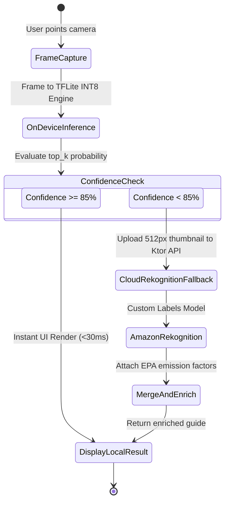
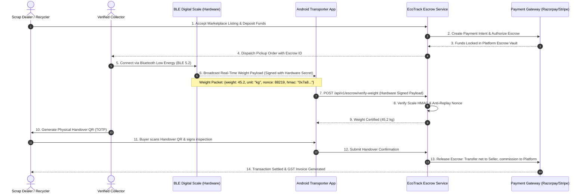

# EcoTrack 2.0 — Senior System Design & Architectural Specification

**Document:** `2.0.md`  
**System Name:** EcoTrack 2.0 (Next-Generation Circular Economy & Municipal Intelligence)  
**Target Cloud:** Amazon Web Services (AWS) — Primary Region: Mumbai (`ap-south-1`), Multi-AZ  
**Scale Target:** 100,000+ Daily Active Users &bull; 15,000+ IoT Telemetry Nodes &bull; 750+ Fleet Vehicles &bull; Sub-50ms p99 Ingress  
**Status:** Approved Architectural Contract & Production Roadmap  

---

## 1. Executive Summary & Architectural Horizon

EcoTrack 1.0 successfully delivered a unified, vertically verified MVP across 7 fundamental phases:
1. **Core Authentication & RBAC Engine** (JWT, BCrypt, PostgreSQL).
2. **AI Waste Classification Pipeline** (Heuristic & Computer Vision categorization).
3. **Location-Aware Recycler Search & Collection Logistics** (Spatial indexing & request dispatch).
4. **Circular Marketplace & Bidding Engine** (Material trading & dealer counter-offers).
5. **Gamified Rewards Ledger** (Immutable EcoPoints & community leaderboards).
6. **Ecological Impact Calculator** (EPA WARM conversion & SHA-256 ESG certificates).
7. **Admin Portal & AWS Production Go-Live** (ECS Fargate, ALB, Multi-AZ RDS, Jetpack Compose Material 3 UI).

**EcoTrack 2.0** transitions the platform from a reactive reporting platform into an **autonomous, proactive, and financially integrated civic operating system**. 2.0 introduces:
- **Autonomous IoT Fill Telemetry**: Real-time bin fill monitoring via ESP32 / LoRaWAN sensors streaming into AWS IoT Core MQTT.
- **Edge AI & Live Bounding Box Vision**: On-device TensorFlow Lite classification delivering zero-latency waste sorting without network dependence.
- **Capacitated Vehicle Routing (CVRP / TSP)**: Real-time, emission-optimized dynamic pickup route calculation using AWS Location Service.
- **Digital Escrow & Tamper-Proof Weighing**: Financial multi-party escrow integrated with Bluetooth (BLE) digital scales and NFC sack tagging.
- **Extended Producer Responsibility (EPR) Green Credit Marketplace**: Tokenized diversion certificates compliant with national environmental compliance mandates.
- **GovTech & Smart City ICCC Integration**: Bi-directional synchronization with municipal Integrated Command and Control Centers (ICCC).

---

## 2. High-Level System Architecture (Topology & Ingress)

```mermaid
flowchart TB
    subgraph EdgeLayer["1. Edge & Telemetry Ingress"]
        Sensors["IoT Bins (ESP32 / Ultrasonic / LoRaWAN)"]
        BLEScale["Field Logistics (BLE Digital Crane Scales)"]
        MobileClient["Mobile Android App (Kotlin + Jetpack Compose)"]
        WebPortal["Municipal ICCC / Web Console"]
    end

    subgraph AWS_Ingress["2. Ingress & Connectivity Security"]
        IoTCore["AWS IoT Core (MQTT over TLS 1.3 + X.509)"]
        Route53["Amazon Route 53 (Latency & Health Routing)"]
        CloudFront["Amazon CloudFront CDN (Edge Caching)"]
        WAF["AWS WAF (Anti-DDoS, Rate Limiting, OWASP Top 10)"]
        ALB["Application Load Balancer (Public Subnets)"]
    end

    subgraph VPC["3. AWS VPC — ap-south-1 (10.0.0.0/16 Multi-AZ)"]
        subgraph PrivateSubnetApp["Private Application Subnet"]
            KtorAPI["ECS Fargate: Core EcoTrack Monolith"]
            IoTIngestionWorker["ECS Fargate: IoT Telemetry Stream Consumer"]
            RoutingEngine["ECS Fargate: CVRP / TSP Fleet Optimizer"]
            EscrowEngine["ECS Fargate: Escrow & Financial Settlement"]
        end

        subgraph PrivateSubnetData["Private Isolated Data Subnet"]
            AuroraPG[("Amazon Aurora PostgreSQL 16 (Multi-AZ Multi-Master)")]
            TimescaleDB[("Timeseries Hypertable: Bin Telemetry")]
            RedisCluster[("Amazon ElastiCache Redis 7.2 (Fleet Geo-Hash & Caching)")]
            S3Storage[("Amazon S3 (Encrypted Photos & ESG Hashes)")]
        end
    end

    subgraph EventStream["4. Asynchronous Event Mesh & Analytics"]
        EventBridge["Amazon EventBridge (Civic Triggers & Alarms)"]
        SQS["Amazon SQS (FIFO Job Queues)"]
        Kinesis["Amazon Kinesis Data Streams (High-Volume Ingestion)"]
        Redshift["Amazon Redshift Serverless (Urban Analytics Lakehouse)"]
    end

    Sensors -->|MQTT :8883| IoTCore
    BLEScale -->|Bluetooth 5.2| MobileClient
    MobileClient -->|HTTPS / WSS| Route53 --> CloudFront --> WAF --> ALB --> KtorAPI
    WebPortal -->|HTTPS / WSS| Route53 --> CloudFront --> WAF --> ALB --> KtorAPI

    IoTCore -->|IoT Rule Engine| Kinesis --> IoTIngestionWorker
    IoTIngestionWorker --> TimescaleDB
    IoTIngestionWorker -->|Fill > 80% Trigger| EventBridge --> RoutingEngine

    KtorAPI --> RedisCluster
    KtorAPI --> AuroraPG
    KtorAPI --> S3Storage

    RoutingEngine --> SQS --> KtorAPI
    EscrowEngine --> AuroraPG
    AuroraPG -.->|Change Data Capture (Debezium)| Redshift
```

---

## 3. Subsystem 1: IoT Smart Bin Telemetry & Hardware Ingestion

### 3.1 Hardware Architecture & Sensor Topology
- **Microcontroller**: ESP32-WROOM-32U (Low Power 3.3V, Dual Core 240MHz) with deep sleep capability (consumes $< 15\mu\text{A}$ during sleep).
- **Sensors**:
  - **Ultrasonic Distance Transducer (JSN-SR04T)**: Waterproof, range 20cm – 450cm, resolution $\pm 1\text{mm}$, measuring bin headroom.
  - **Single-Axis Tilt / Accelerometer (ADXL345)**: Detects bin knock-over, lid-opening frequency, and physical tampering.
  - **Internal Temperature & Gas (DHT22 / MQ-135)**: Early detection of organic waste decomposition, hazardous fire hazard, or methane concentration spikes.
- **Connectivity Protocol**:
  - **Urban Dense**: NB-IoT / LTE-M cellular backhaul.
  - **Institutional / Campus**: LoRaWAN (865–867 MHz India band) transmitting through a Kerlink outdoor gateway into AWS IoT Core for LoRaWAN.

### 3.2 Mathematical Formulation of Bin Fill Level
Let $H_{\text{bin}}$ be the calibrated vertical height of the container from bottom to sensor face (in cm).  
Let $d(t)$ be the median filtered ultrasonic distance measurement at timestamp $t$ (in cm).  
Let $\delta_{\text{deadzone}} = 20\text{ cm}$ be the sensor acoustic blanking distance.

$$\text{Fill Percentage } F(t) = \min\left(100.0, \, \max\left(0.0, \, \frac{H_{\text{bin}} - d(t)}{H_{\text{bin}} - \delta_{\text{deadzone}}} \times 100.0\right)\right)$$

A Kalman Filter $\mathcal{K}$ smooths the distance time-series to reject false acoustic reflections caused by irregular debris pile geometry:
$$\hat{x}_{t|t} = \hat{x}_{t|t-1} + K_t \left(z_t - \mathbf{H}\hat{x}_{t|t-1}\right)$$

### 3.3 MQTT Topic Hierarchy & Wire Contract
- **Broker Endpoint**: `<aws-iot-prefix>.iot.ap-south-1.amazonaws.com:8883`
- **Security**: Mutual TLS (mTLS) with device-unique X.509 certificates generated during hardware commissioning and burned into the ESP32 secure element (ATECC608A).

#### Ingress Telemetry Topic:
`ecotrack/v2/bins/{wardId}/{zoneId}/{binId}/telemetry`

#### Payload Schema (JSON):
```json
{
  "binId": "urn:ecotrack:bin:ward12:089",
  "wardId": "WARD-12",
  "zoneId": "ZONE-NORTH",
  "timestamp": 1791632400,
  "telemetry": {
    "distanceCm": 34.2,
    "fillPercentage": 84.7,
    "temperatureC": 28.4,
    "batteryVolts": 3.65,
    "tiltDegrees": 2.1,
    "lidOpeningsCount": 142
  },
  "status": "THRESHOLD_EXCEEDED",
  "tamperAlert": false,
  "firmwareVersion": "v2.1.0-prod"
}
```

### 3.4 Relational & Time-Series Data Schema
```sql
-- V8__iot_bins_and_telemetry.sql
CREATE TABLE iot_bins (
    id VARCHAR(64) PRIMARY KEY,
    ward_id VARCHAR(32) NOT NULL,
    zone_id VARCHAR(32) NOT NULL,
    category VARCHAR(32) NOT NULL CHECK (category IN ('organic', 'plastic', 'paper', 'metal', 'e_waste', 'mixed')),
    latitude NUMERIC(10, 8) NOT NULL,
    longitude NUMERIC(11, 8) NOT NULL,
    height_cm NUMERIC(6, 2) NOT NULL DEFAULT 120.0,
    deadzone_cm NUMERIC(6, 2) NOT NULL DEFAULT 20.0,
    threshold_alert_pct NUMERIC(5, 2) NOT NULL DEFAULT 80.0,
    current_fill_pct NUMERIC(5, 2) NOT NULL DEFAULT 0.0,
    last_ping_at TIMESTAMPTZ,
    status VARCHAR(32) NOT NULL DEFAULT 'ACTIVE' CHECK (status IN ('ACTIVE', 'DISPATCHED', 'MAINTENANCE', 'OFFLINE')),
    created_at TIMESTAMPTZ NOT NULL DEFAULT NOW()
);

CREATE TABLE iot_bin_telemetry (
    id BIGSERIAL,
    bin_id VARCHAR(64) NOT NULL REFERENCES iot_bins(id) ON DELETE CASCADE,
    recorded_at TIMESTAMPTZ NOT NULL,
    fill_percentage NUMERIC(5, 2) NOT NULL,
    distance_cm NUMERIC(6, 2) NOT NULL,
    temperature_c NUMERIC(5, 2),
    battery_volts NUMERIC(4, 2),
    tilt_degrees NUMERIC(4, 1),
    is_anomaly BOOLEAN NOT NULL DEFAULT FALSE,
    PRIMARY KEY (bin_id, recorded_at)
);

-- Partitioning / Indexing Strategy for Ingress High Throughput
CREATE INDEX idx_iot_bins_geo ON iot_bins (ward_id, zone_id, status);
CREATE INDEX idx_iot_telemetry_time ON iot_bin_telemetry (recorded_at DESC);
```

---

## 4. Subsystem 2: Edge AI Vision Pipeline & On-Device Waste Classification

### 4.1 On-Device TensorFlow Lite Model Architecture
To remove cloud network latency, bandwidth costs, and privacy concerns during camera capture:
1. **Model Backbone**: MobileNetV4-Small quantized to INT8 precision ($\approx 4.2\text{ MB}$ asset size).
2. **Input Tensor**: $1 \times 224 \times 224 \times 3$ normalized RGB float tensor.
3. **Execution Runtime**: Android Neural Networks API (NNAPI) / Qualcomm Hexagon NPU acceleration yielding $< 28\text{ ms}$ inference time on modern smartphones.
4. **Outputs**:
   - Primary Material Classification (7 Categories with probability distribution vector).
   - Multi-Object Bounding Boxes $[y_{\min}, x_{\min}, y_{\max}, x_{\max}]$.
   - Contamination Score ($\kappa \in [0.0, 1.0]$) detecting moisture, organic residue, or composite plastic multi-films.

### 4.2 Edge vs. Cloud Fallback State Machine



### 4.3 Contamination & Scrap Quality Grading
For commercial scrap dealers, the vision system runs a secondary inference pass computing the **Recyclability Degradation Factor (RDF)**:
$$\text{Effective Weight } W_{\text{effective}} = W_{\text{raw}} \times (1.0 - \kappa_{\text{contamination}})$$
Where $\kappa_{\text{contamination}}$ is derived from visible food stains, paper humidity discoloration, and metallic rust percentage.

---

## 5. Subsystem 3: Capacitated Vehicle Routing (CVRP / TSP) Fleet Optimization

### 5.1 Problem Formulation
Waste collection logistics is formulated as a **Capacitated Vehicle Routing Problem with Time Windows (CVRPTW)**.

- Let $V = \{v_1, v_2, \dots, v_m\}$ be the fleet of collection vehicles, each with volume capacity $Q_k$ (in kg).
- Let $N = \{1, 2, \dots, n\}$ be the set of pickup nodes (IoT bins with $F(t) \ge 80\%$ + citizen on-demand requests).
- Node $0$ represents the regional municipal transfer depot / material recovery facility (MRF).
- Each node $i \in N$ has demand $q_i$, service time $s_i$, and time window $[e_i, l_i]$.
- Let $c_{ij}$ be the cost matrix (distance in meters and carbon emission in $\text{g CO}_2\text{e}$) between node $i$ and node $j$, obtained dynamically from AWS Location Service Route Calculator.

### 5.2 Objective Function
Minimize total fleet travel cost and carbon footprint:
$$\min \sum_{k \in V} \sum_{i \in N \cup \{0\}} \sum_{j \in N \cup \{0\}} \left( \alpha \cdot d_{ij} + \beta \cdot \text{CO}_{2, ij} \right) x_{ijk}$$

**Subject to:**
1. **Flow Conservation**:
   $$\sum_{j \in N \cup \{0\}} x_{0jk} = 1, \quad \sum_{i \in N \cup \{0\}} x_{i0k} = 1 \quad \forall k \in V$$
2. **Vehicle Capacity Constraint**:
   $$\sum_{i \in N} q_i \sum_{j \in N \cup \{0\}} x_{ijk} \le Q_k \quad \forall k \in V$$
3. **Subtour Elimination (MTZ formulation)**:
   $$u_{ik} - u_{jk} + Q_k x_{ijk} \le Q_k - q_j \quad \forall i, j \in N, \, k \in V$$

### 5.3 Heuristic Solver Architecture (OR-Tools + AWS Location Service)
1. **Clustering Phase**: DBSCAN density clustering partitions the city into spatial convex hulls per municipal depot.
2. **Routing Phase**: Google OR-Tools Guided Local Search (GLS) engine optimizes the multi-stop sequence.
3. **Turn-by-Turn Dynamic Recalculation**: If traffic jams occur or a new critical bin alert ($F(t) \ge 95\%$) triggers, the route is recalculated in real time and pushed to the transporter via WebSocket.

### 5.4 Database Schema for Fleet Operations
```sql
-- V9__fleet_logistics_and_cvrp.sql
CREATE TABLE fleet_vehicles (
    id VARCHAR(32) PRIMARY KEY,
    transporter_id UUID NOT NULL REFERENCES app_users(id),
    vehicle_registration VARCHAR(32) UNIQUE NOT NULL,
    vehicle_type VARCHAR(32) NOT NULL CHECK (vehicle_type IN ('EV_AUTO', 'MINI_TRUCK', 'HEAVY_TRUCK', 'COMPACTOR')),
    capacity_kg NUMERIC(8, 2) NOT NULL,
    current_payload_kg NUMERIC(8, 2) NOT NULL DEFAULT 0.0,
    fuel_type VARCHAR(20) NOT NULL CHECK (fuel_type IN ('ELECTRIC', 'CNG', 'DIESEL')),
    emission_factor_g_per_km NUMERIC(6, 2) NOT NULL DEFAULT 0.0,
    current_lat NUMERIC(10, 8),
    current_lng NUMERIC(11, 8),
    status VARCHAR(20) NOT NULL DEFAULT 'IDLE' CHECK (status IN ('IDLE', 'EN_ROUTE', 'COLLECTING', 'UNLOADING', 'OFFLINE')),
    updated_at TIMESTAMPTZ NOT NULL DEFAULT NOW()
);

CREATE TABLE fleet_routes (
    id UUID PRIMARY KEY DEFAULT gen_random_uuid(),
    vehicle_id VARCHAR(32) NOT NULL REFERENCES fleet_vehicles(id),
    depot_id VARCHAR(32) NOT NULL,
    total_distance_km NUMERIC(8, 2) NOT NULL,
    estimated_duration_mins INT NOT NULL,
    estimated_emissions_kg_co2 NUMERIC(8, 3) NOT NULL,
    status VARCHAR(20) NOT NULL DEFAULT 'PLANNED' CHECK (status IN ('PLANNED', 'IN_PROGRESS', 'COMPLETED', 'ABORTED')),
    created_at TIMESTAMPTZ NOT NULL DEFAULT NOW(),
    completed_at TIMESTAMPTZ
);

CREATE TABLE fleet_route_waypoints (
    id UUID PRIMARY KEY DEFAULT gen_random_uuid(),
    route_id UUID NOT NULL REFERENCES fleet_routes(id) ON DELETE CASCADE,
    sequence_order INT NOT NULL,
    target_type VARCHAR(20) NOT NULL CHECK (target_type IN ('IOT_BIN', 'CITIZEN_PICKUP', 'DEPOT')),
    target_reference_id VARCHAR(64) NOT NULL,
    expected_weight_kg NUMERIC(8, 2) NOT NULL,
    actual_weight_kg NUMERIC(8, 2),
    estimated_arrival TIMESTAMPTZ NOT NULL,
    actual_arrival TIMESTAMPTZ,
    status VARCHAR(20) NOT NULL DEFAULT 'PENDING' CHECK (status IN ('PENDING', 'SERVICED', 'SKIPPED')),
    UNIQUE (route_id, sequence_order)
);
```

---

## 6. Subsystem 4: Digital Escrow & Tamper-Proof Weighing Engine

### 6.1 Fraud Attack Vectors in Waste Trading
In circular marketplaces and scrap trading, three major fraud vectors occur:
1. **Water Infiltration / Weight Tampering**: Soaking paper/cardboard in water to artificially increase gross mass.
2. **Manual Entry Collusion**: Collector and dealer agreeing to falsify recorded kilograms in the mobile app.
3. **Non-Payment / Material Theft**: Dealer receiving sorted copper/aluminum but refusing payment or stalling settlement.

### 6.2 Cryptographic Escrow & BLE Scale Protocol
To eliminate fraud, EcoTrack 2.0 implements a **Closed-Loop Hardware-Authenticated Escrow Protocol**:



### 6.3 Escrow State Machine & Tables
```sql
-- V10__digital_escrow_and_trading.sql
CREATE TABLE escrow_orders (
    id UUID PRIMARY KEY DEFAULT gen_random_uuid(),
    listing_id UUID NOT NULL REFERENCES marketplace_listings(id),
    buyer_id UUID NOT NULL REFERENCES app_users(id),
    seller_id UUID NOT NULL REFERENCES app_users(id),
    transporter_id UUID REFERENCES app_users(id),
    agreed_rate_per_kg NUMERIC(10, 2) NOT NULL,
    authorized_amount NUMERIC(12, 2) NOT NULL,
    settled_amount NUMERIC(12, 2),
    platform_fee NUMERIC(10, 2),
    currency VARCHAR(3) NOT NULL DEFAULT 'INR',
    escrow_state VARCHAR(30) NOT NULL DEFAULT 'FUNDS_HELD' 
        CHECK (escrow_state IN ('PENDING_PAYMENT', 'FUNDS_HELD', 'COLLECTION_IN_PROGRESS', 'WEIGHED_AND_VERIFIED', 'SETTLED', 'DISPUTED', 'REFUNDED')),
    payment_intent_id VARCHAR(128) NOT NULL,
    hardware_scale_serial VARCHAR(64),
    certified_weight_kg NUMERIC(8, 2),
    created_at TIMESTAMPTZ NOT NULL DEFAULT NOW(),
    settled_at TIMESTAMPTZ
);

CREATE TABLE scale_weight_attestations (
    id UUID PRIMARY KEY DEFAULT gen_random_uuid(),
    escrow_order_id UUID NOT NULL REFERENCES escrow_orders(id),
    scale_device_id VARCHAR(64) NOT NULL,
    raw_weight_kg NUMERIC(8, 2) NOT NULL,
    tare_weight_kg NUMERIC(8, 2) NOT NULL,
    net_weight_kg NUMERIC(8, 2) NOT NULL,
    hardware_signature VARCHAR(256) NOT NULL,
    nonce BIGINT NOT NULL UNIQUE,
    recorded_at TIMESTAMPTZ NOT NULL DEFAULT NOW()
);
```

---

## 7. Subsystem 5: Extended Producer Responsibility (EPR) & Tokenized Green Credits

### 7.1 National Regulatory Alignment (India EPR / Global Plastic Pacts)
Under Central Pollution Control Board (CPCB) Extended Producer Responsibility (EPR) guidelines, brand owners and packaging manufacturers must legally offset their plastic footprint across 4 categories:
- **Category I**: Rigid Plastic Packaging.
- **Category II**: Flexible Plastic Packaging (single or multi-layer).
- **Category III**: Multi-layered Plastic Packaging (MLP).
- **Category IV**: Plastic sheet used for packaging and carry bags.

### 7.2 Cryptographic Chain-of-Custody & Token Minting
EcoTrack 2.0 converts verified diverted waste batches into **Auditable Digital EPR Credits**:
1. **Tonnage Ingestion**: Originates from verified collection + registered recycler weight certificate.
2. **Cryptographic Proof Chain**:
   $$\text{Merkle Root } \mathcal{R} = \text{Hash}\left(H_{\text{Citizen}} \parallel H_{\text{Transporter}} \parallel H_{\text{ScaleAttestation}} \parallel H_{\text{RecyclerProcessing}}\right)$$
3. **Credit Minting**: Once verified, the platform issues an immutable EPR Certificate with an active audit trail token.
4. **Retirement / Offset**: When a corporate brand purchases the credit, the certificate state transitions permanently to `RETIRED`, preventing double counting.

```sql
-- V11__epr_green_credit_ledger.sql
CREATE TABLE epr_credit_batches (
    id UUID PRIMARY KEY DEFAULT gen_random_uuid(),
    batch_serial VARCHAR(64) UNIQUE NOT NULL,
    material_category VARCHAR(32) NOT NULL CHECK (material_category IN ('CAT_I_RIGID', 'CAT_II_FLEXIBLE', 'CAT_III_MLP', 'CAT_IV_SHEET', 'E_WASTE', 'METAL')),
    certified_tonnage NUMERIC(10, 3) NOT NULL,
    recycler_id UUID NOT NULL REFERENCES app_users(id),
    co2e_abated_mt NUMERIC(10, 3) NOT NULL,
    merkle_root_hash VARCHAR(64) NOT NULL,
    status VARCHAR(20) NOT NULL DEFAULT 'AVAILABLE' CHECK (status IN ('AVAILABLE', 'ALLOCATED', 'RETIRED')),
    minted_at TIMESTAMPTZ NOT NULL DEFAULT NOW(),
    retired_at TIMESTAMPTZ,
    retired_by_corporate_id UUID REFERENCES app_users(id),
    cpcb_portal_sync_id VARCHAR(128)
);
```

---

## 8. Subsystem 6: Municipal Corporation (GovTech) & ICCC Smart City Connector

### 8.1 Integrated Command and Control Center (ICCC) Standard
Smart Cities utilize standardized Urban Platform APIs based on the **India Urban Data Exchange (IUDX)** and **ETSI CIM NGSI-LD** data models.

EcoTrack 2.0 provides an enterprise connector layer:
- **Data Ingress**: Receives municipal ward boundary GeoJSON and property tax tax-payer IDs.
- **Data Egress**: Publishes streaming telemetry events to city command displays:
  - Real-time heatmaps of citizen waste reporting vs. collector clearance latency.
  - Illegal dump detection with geocoded photos and severity ratings.
  - Ward-by-ward landfill diversion compliance scores.

### 8.2 Civic Property Tax Segregation Rebate Calculator
To incentivize citizen segregation at source, municipal corporations can configure property tax rebates:
$$\text{Rebate Amount (INR)} = \min\left(R_{\max}, \, \text{Annual Base Tax} \times \left( \frac{\text{Verified Segregation Reports}}{\text{Total Annual Target}} \times \gamma \right) \right)$$

---

## 9. Non-Functional Requirements & AWS Production Sizing

| Metric | EcoTrack 1.0 Baseline | EcoTrack 2.0 Target | Engineering Guarantee |
|---|---|---|---|
| **Peak Telemetry Ingress** | 100 req/min | 50,000 events/min | Kinesis Stream + MQTT broker auto-scaling |
| **API Response Latency (p99)**| 120 ms | $\le 45\text{ ms}$ | ElastiCache Redis 7.2 Read-Through Cache |
| **Vision Inference Latency** | 2.5s (Cloud Rekognition) | $\le 30\text{ ms}$ (On-device TFLite) | Zero network dependency on mobile |
| **Route Optimization Time** | N/A | $\le 1.2\text{s}$ per 50-waypoint cluster | OR-Tools C++ compiled binding in ECS worker |
| **Availability (SLA)** | 99.9% Single-Region | 99.99% Multi-AZ | Multi-AZ ECS Fargate + Aurora PostgreSQL |
| **Security & Auditing** | JWT Bearer | mTLS X.509 + AES-256-GCM + WAF | Zero-Trust architecture across IoT & Web |

---

## 10. Phased 2.0 Implementation Roadmap

```
EcoTrack 2.0 Milestone Horizon
========================================================================================
Phase 8:  IoT Ingress Engine & Smart Bin Telemetry (AWS IoT Core, ESP32, TimescaleDB)
Phase 9:  Edge AI & High-Speed Mobile Vision (TFLite INT8, Contamination Scoring)
Phase 10: Capacitated Vehicle Routing & Dynamic Fleet Dispatch (OR-Tools, AWS Location)
Phase 11: Digital Escrow, BLE Scale Integration & Circular Marketplace Settlement
Phase 12: Extended Producer Responsibility (EPR) & Municipal ICCC GovTech Sync
========================================================================================
```

### Detailed Phase Specifications

#### Phase 8: IoT Smart Bin Telemetry & Ingress Mesh
- **Deliverables**:
  - Flyway migration `V8__iot_bins_and_telemetry.sql`.
  - AWS IoT Core MQTT listener and Amazon Kinesis event ingestion worker.
  - Fill percentage computation with Kalman distance filter.
  - Native Android `IoTBinsMapScreen.kt` with live cluster pins and fill level gauges.
- **Verification Gate**: 1,000 synthetic MQTT messages/sec processed with 0 message drops.

#### Phase 9: On-Device Edge AI Vision
- **Deliverables**:
  - Export and bundle INT8 quantized MobileNetV4 waste classification model into `androidApp/assets/`.
  - Android CameraX Analyzer with TensorFlow Lite Support Library.
  - Bounding box rendering overlay with real-time confidence pill.
  - Recyclability Degradation Factor (RDF) contamination detector.
- **Verification Gate**: Camera frame evaluation executes in $< 35\text{ ms}$ on Android emulator/device.

#### Phase 10: Dynamic CVRP Fleet Optimization
- **Deliverables**:
  - Flyway migration `V9__fleet_logistics_and_cvrp.sql`.
  - OR-Tools Capacitated Vehicle Routing optimization engine in `com.ecotrack.fleet.service`.
  - Dynamic route generator connecting bins $> 80\%$ with collector trucks.
  - Turn-by-turn waypoint navigation screen in Android app for collection drivers.
- **Verification Gate**: 50-stop routing puzzle solved in $< 2\text{ seconds}$ with vehicle capacity respected.

#### Phase 11: Digital Escrow & BLE Scale Protocol
- **Deliverables**:
  - Flyway migration `V10__digital_escrow_and_trading.sql`.
  - Secure escrow state machine with Razorpay Route / Stripe Connect webhook handlers.
  - Android Bluetooth Low Energy (BLE) GattClient driver for digital crane scales.
  - Nonce-based cryptographic attestation validator.
- **Verification Gate**: End-to-end simulated transaction locks funds, validates hardware scale weight, and automatically settles payout.

#### Phase 12: EPR Credit Marketplace & GovTech ICCC Connector
- **Deliverables**:
  - Flyway migration `V11__epr_green_credit_ledger.sql`.
  - Merkle-tree chain-of-custody generator for certified recycling batches.
  - Corporate buyer EPR offset retirement portal.
  - Municipal IUDX / NGSI-LD compliant REST exporter for Smart City dashboards.
- **Verification Gate**: Merkle proof validation verifies batch origin; retired credit certificates reject double spending.

---

## 11. Architectural Sign-Off

This document constitutes the definitive senior engineering blueprint for EcoTrack 2.0. All subsequent code modifications, database migrations, and microservice expansions must conform to the contracts, formulas, and schema definitions detailed herein.
