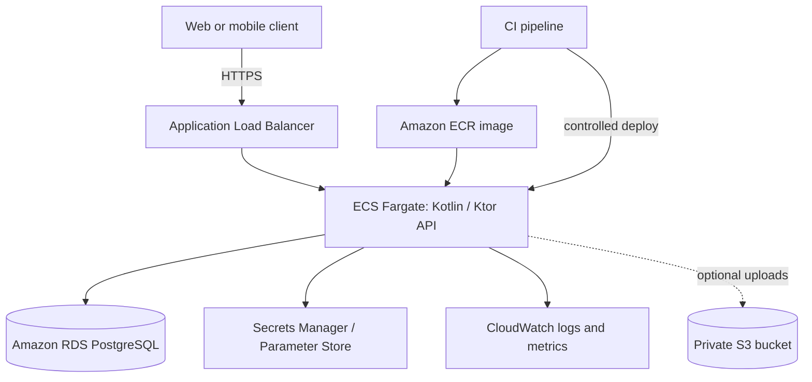

# EcoTrack — Real-World Implementation Architecture
**Version:** 1.0  
**Purpose:** A buildable, deployable baseline for a student engineering team  
**Status:** Implementation blueprint; validate product-specific requirements before production launch

> **Scope note:** This document turns the EcoTrack architecture into a practical implementation plan. It makes explicit assumptions where product requirements were not available. Replace the example domain entities and workflows with the confirmed EcoTrack requirements before treating this as a final product specification.

## 1. Executive summary

Build EcoTrack as a modular Kotlin/Ktor API backed by PostgreSQL, deployed initially as a containerized service on AWS. Keep the first release small: one API service, one relational database, object storage only if files are required, and managed secrets/logging. Avoid microservices, Kubernetes, Kafka, and multi-region infrastructure until measured needs justify them.

**First-release outcome:** a deployed HTTPS API, authenticated users, validated data writes, database migrations, automated tests, backups, observable failures, and a repeatable deployment process.

## 2. Assumptions and decisions to confirm

The exact business requirements were not included with this request, so the design uses these working assumptions:
- EcoTrack stores user-owned environmental/activity records and may produce summaries or reports.
- Users must only access records they are authorized to see.
- A mobile or web client calls a JSON REST API.
- The team is comfortable with Kotlin and SQL, but has limited operations capacity.
- Initial traffic is modest and predictable.

Before implementation, confirm: target users, core record types, retention policy, whether GPS/location data is collected, whether files/photos are uploaded, expected daily active users, and any legal/privacy requirements. Do not collect precise location or personal data unless the feature requires it.

## 3. MVP versus later phases

### MVP — required for a credible real-world pilot
- Kotlin/Ktor REST API with request validation and consistent error responses.
- PostgreSQL with versioned migrations, foreign keys, unique constraints, and indexes.
- Authentication and server-side authorization on every protected resource.
- HTTPS, managed secrets, restricted database network access.
- Automated unit/integration tests and CI checks.
- Structured logs, health endpoints, error monitoring, backups, and restore test.
- Staging and production environments with repeatable deployment.

### Later, only when justified
- Background jobs for expensive reports or scheduled processing.
- S3 uploads for user files.
- Queue/event processing when synchronous processing becomes unreliable.
- Read replicas, caching, multi-AZ expansion, or multi-region recovery.
- Analytics warehouse and advanced dashboards.

## 4. Recommended AWS architecture

**MVP path:** Route 53 (domain) → ACM TLS certificate → Application Load Balancer → ECS Fargate service running the Ktor container → private Amazon RDS for PostgreSQL. Store images/files in S3 only if the product needs them. Use CloudWatch for logs/metrics, Secrets Manager or SSM Parameter Store for secrets, and ECR for container images.

For a small pilot, a single ECS service with desired count 1 is cheaper but has downtime risk during deployments or host/task failure. For a public production service, use at least two tasks across Availability Zones and a suitably configured database deployment. Cost and availability requirements must decide this, not guesswork.

**Network rules**
- ALB: public subnets; inbound 443 from the internet (and 80 only to redirect to 443).
- ECS tasks: private subnets; inbound application port only from the ALB security group.
- RDS: private subnets; inbound PostgreSQL port 5432 only from the ECS security group.
- No public IP or public database endpoint for RDS.
- Restrict outbound access where practical; use VPC endpoints/NAT based on cost and service needs.

## 5. Architecture diagram



## 6. Backend structure

Use a modular monolith, not microservices. Suggested package layout:

```text
src/main/kotlin/com/ecotrack/
  Application.kt
  config/
  plugins/             # auth, serialization, validation, monitoring
  common/               # error model, clock, IDs, pagination
  auth/
    api/
    service/
    repository/
  users/
    api/
    service/
    repository/
  records/              # replace with confirmed EcoTrack domain modules
    api/
    service/
    repository/
  reports/
    api/
    service/
  database/
  jobs/                 # add only if asynchronous work is needed
src/test/kotlin/com/ecotrack/
```

Keep HTTP routes thin. Route handlers parse and validate requests, call services, and map domain results to response DTOs. Services enforce business rules and authorization. Repositories contain SQL/data-access logic. Do not expose database entities directly as public API responses.

## 7. Kotlin/Ktor implementation choices

- Kotlin with a currently supported JDK LTS version.
- Ktor server, content negotiation with kotlinx.serialization, status pages, authentication, and request logging.
- Exposed or jOOQ/JDBC for database access; choose one and use it consistently. For a SQL-heavy student project, plain SQL/JDBC or jOOQ makes query behavior visible.
- HikariCP connection pool.
- Flyway for schema migrations.
- Gradle Kotlin DSL with dependency locking or dependency verification where feasible.
- OpenAPI specification generated or maintained alongside route DTOs.
- Pin dependency versions and update them regularly; do not copy unreviewed snippets from old tutorials.

Example Gradle dependencies (versions should be pinned to current compatible releases in the project):
- Ktor server core, Netty, content negotiation, kotlinx JSON, status pages, authentication/JWT if using JWT, call logging.
- PostgreSQL JDBC driver.
- HikariCP.
- Flyway.
- Kotlin test, Ktor test host, Testcontainers PostgreSQL, and a mocking library only where useful.

## 8. Data model and PostgreSQL schema

The final schema must follow confirmed product requirements. A generic starting point for user-owned records is below; rename `activity_records` to the actual domain concept before implementation.

```sql
CREATE TABLE app_users (
    id              UUID PRIMARY KEY,
    email           TEXT NOT NULL,
    password_hash   TEXT,
    display_name    TEXT NOT NULL,
    status          TEXT NOT NULL DEFAULT 'active'
                    CHECK (status IN ('active', 'disabled', 'pending')),
    created_at      TIMESTAMPTZ NOT NULL DEFAULT now(),
    updated_at      TIMESTAMPTZ NOT NULL DEFAULT now()
);

CREATE UNIQUE INDEX app_users_email_lower_uq
    ON app_users (lower(email));

CREATE TABLE activity_records (
    id              UUID PRIMARY KEY,
    owner_user_id   UUID NOT NULL REFERENCES app_users(id) ON DELETE RESTRICT,
    record_type     TEXT NOT NULL,
    title           TEXT NOT NULL,
    quantity        NUMERIC(12, 3),
    unit            TEXT,
    occurred_at     TIMESTAMPTZ NOT NULL,
    notes           TEXT,
    created_at      TIMESTAMPTZ NOT NULL DEFAULT now(),
    updated_at      TIMESTAMPTZ NOT NULL DEFAULT now(),
    deleted_at      TIMESTAMPTZ
);

CREATE INDEX activity_records_owner_occurred_idx
    ON activity_records (owner_user_id, occurred_at DESC)
    WHERE deleted_at IS NULL;
```

Important:
- Store timestamps as `TIMESTAMPTZ` and use UTC in services.
- Use UUIDs for externally visible IDs.
- Add constraints for valid quantities, units, states, and relationships.
- Avoid storing derived totals if they can be computed reliably; if materialized for performance, define how they stay correct.
- Do not use a generic JSON column as a substitute for a well-defined schema.
- Add `created_at`/`updated_at` consistently and update `updated_at` in application logic or a well-tested database trigger.
- Use migrations, not manual production schema edits.

## 9. Data access and transactions

- Put multi-step writes inside a database transaction.
- Use prepared statements/parameterized queries; never concatenate user input into SQL.
- Enforce owner/tenant filters in repository queries and verify access in the service layer.
- Set sensible query and connection timeouts.
- Keep transactions short; never hold a transaction open while calling a remote service.
- Add pagination to list endpoints (`limit` capped, stable cursor/order, deterministic tie-breaker).
- Define deletion semantics: hard delete, soft delete, or retention-based purge. Do not mix these casually.
- Use an idempotency key for operations where clients may retry and duplicate creation would be harmful.

## 10. REST API contract

Use a versioned prefix such as `/api/v1`. Example endpoints; confirm names against the real product:

| Method | Path | Purpose |
|---|---|---|
| GET | `/health/live` | Process is alive; no dependency checks |
| GET | `/health/ready` | Ready to serve; bounded database check |
| GET | `/api/v1/me` | Current user profile |
| GET | `/api/v1/records` | List caller-authorized records, paginated |
| POST | `/api/v1/records` | Create a record |
| GET | `/api/v1/records/{id}` | Read one authorized record |
| PATCH | `/api/v1/records/{id}` | Update allowed fields |
| DELETE | `/api/v1/records/{id}` | Delete/archive according to policy |

Use JSON request/response bodies. Return `201 Created` with a resource representation for successful creation, `204 No Content` for successful deletion where appropriate, `400` for malformed input, `401` for unauthenticated requests, `403` for authenticated but forbidden actions (or consistently use `404` to avoid disclosing resource existence), `404` for missing resources, `409` for conflicts, `422` for well-formed but invalid domain input if the API adopts it, and `429` for rate limits.

Standard error shape:

```json
{
  "error": {
    "code": "VALIDATION_ERROR",
    "message": "The request contains invalid fields.",
    "requestId": "server-generated-correlation-id",
    "details": [
      {"field": "title", "reason": "must not be blank"}
    ]
  }
}
```

Never return stack traces, SQL text, secrets, or internal exception messages to clients.

## 11. Authentication and authorization

Choose the auth model based on the client:
- If the team uses a trusted identity provider, use its OIDC/OAuth2 flow and validate issuer, audience, signature, expiry, and relevant claims on the server.
- If implementing passwords, use a vetted password-hashing algorithm/library (Argon2id or bcrypt with appropriate cost), unique normalized email, password reset tokens with short expiry, and login throttling. Never store plaintext passwords or reversible password encryption.
- JWTs are not a substitute for authorization. Validate all claims and keep access-token lifetime short; define refresh-token rotation/revocation if refresh tokens are used.
- For every record endpoint, enforce ownership or role-based access on the server. Never trust a user ID supplied in the request body as proof of identity.
- Add CSRF protection when using cookie-based browser sessions. Use secure, HttpOnly, SameSite cookies and correct CORS settings.
- Implement account disablement and token/session invalidation requirements.

## 12. Security and privacy controls

- TLS for all public traffic; redirect HTTP to HTTPS.
- Secrets stored in Secrets Manager/SSM, not Git, Docker images, logs, or frontend bundles.
- Separate IAM roles for CI deployment and runtime; least privilege.
- Validate request sizes, strings, enums, numbers, timestamps, and uploaded file types.
- Rate-limit login, password reset, and costly endpoints.
- Use parameterized SQL and safe output handling.
- Avoid logging access tokens, passwords, full personal records, or precise location.
- Define data retention, deletion, export, and incident response before collecting sensitive data.
- Keep dependencies patched; scan container images and dependencies in CI.
- Enable audit events for security-relevant actions without logging sensitive payloads.
- Review applicable Indian privacy requirements and any other jurisdictions where users are located with qualified counsel before launch. This blueprint is not legal advice.

## 13. Validation and error handling

Validate at the API boundary and enforce critical invariants again in the domain/database layer:
- Required fields and maximum lengths.
- Allowed units/types and sensible numeric ranges.
- Date/time formats and accepted time zones.
- Ownership and state-transition rules.
- Pagination limits and filter allowlists.
- Content type and request body size.

Map known exceptions to stable error codes. Log unexpected exceptions with request ID and stack trace in restricted server logs. Return generic 500 responses to clients. Do not treat every exception as a 400; distinguish client errors from server failures.

## 14. Observability and operations

Minimum baseline:
- JSON structured logs with timestamp, severity, service, environment, request ID, route template, status code, duration, and safe user identifier where justified.
- Metrics for request rate, error rate, latency percentiles, JVM memory/GC, task restarts, DB connections, DB CPU/storage, and failed jobs.
- Liveness and readiness endpoints with short timeouts.
- Alerts for sustained 5xx errors, high latency, task restart loops, database storage/connection pressure, failed backups, and certificate/domain issues.
- A runbook for rollback, database restore, secret rotation, and incident communication.

Do not add every possible dashboard at MVP. Start with signals that tell the team whether users can use the service and whether data is safe.

## 15. CI/CD and deployment

Suggested pipeline:
1. Pull request: formatting/lint, compile, unit tests, integration tests with disposable PostgreSQL, dependency scan.
2. Merge to main: build immutable container image, scan it, push to ECR with commit SHA tag.
3. Deploy to staging; run smoke tests and migration checks.
4. Manual approval for production initially; deploy the same immutable image.
5. Verify health and key metrics; roll back application image if needed.

Use a non-root container user, a minimal maintained base image, pinned build/runtime versions, and a `.dockerignore`. Inject configuration at runtime. Do not bake environment secrets into the image.

Database migrations should be backward-compatible when rolling deployments are used: add nullable columns first, deploy code that supports both states, backfill, then tighten constraints in a later release. For a small single-task deployment, still take a backup before risky schema changes and have a tested rollback/forward-fix plan.

## 16. Environment configuration

Maintain separate development, staging, and production environments. Typical configuration:
- `APP_ENV`
- `PORT`
- `DATABASE_URL` or split database connection parameters
- `DATABASE_USERNAME` / secret reference
- `AUTH_ISSUER`, `AUTH_AUDIENCE` or identity-provider configuration
- `LOG_LEVEL`
- `CORS_ALLOWED_ORIGINS`
- `REQUEST_TIMEOUT_MS`

Do not store production credentials in `.env` committed to Git. A local untracked `.env.example` should contain names and safe placeholder values only. Validate required configuration on startup and fail fast with a clear log message if missing.

## 17. Backups and disaster recovery

- Enable automated RDS backups and point-in-time recovery appropriate to the selected tier.
- Set a retention period based on business requirements and cost.
- Encrypt database storage and backups.
- Define target recovery point (RPO: how much data loss is acceptable) and recovery time (RTO: how long the service may be down).
- Test restoring a backup into a separate database at least before pilot launch and periodically thereafter.
- Backups are not proven until restore has been tested.
- Document who can initiate restore and how the application is switched to the restored database.

For an MVP, a documented restore process is more valuable than claiming high availability that has never been tested.

## 18. Testing strategy

- **Unit tests:** domain rules, validation, calculations, state transitions.
- **API tests:** route status codes, request/response schema, auth failures, forbidden cross-user access, pagination, error shape.
- **Integration tests:** real PostgreSQL via Testcontainers; migrations from an empty database; constraints and transaction behavior.
- **Security tests:** expired/invalid token, missing authorization, IDOR attempts, rate limits, oversized requests, injection payloads.
- **End-to-end smoke tests:** deployed health, sign-in, create/read/update/delete representative record.
- **Load tests:** only after defining expected usage; test realistic data and query patterns.
- **Recovery test:** restore backup and verify a known record can be read.

Release blockers include failing migrations, cross-user data access, unhandled secrets in logs, broken backups, and untested critical calculations.

## 19. Performance and scaling

Start with measurement, not premature infrastructure:
- Add indexes based on actual query plans and slow-query logs.
- Limit page sizes and avoid N+1 query patterns.
- Set DB connection pool size based on total application tasks and RDS capacity; remember each task has its own pool.
- Keep request handlers non-blocking where practical and move long-running work to background jobs.
- Add caching only for data with clear invalidation rules.
- Scale ECS task count after measuring CPU, memory, latency, and request volume.
- Scale database tier or add read replicas only after identifying the database as the bottleneck.

Do not use Kubernetes, Kafka, Redis, or a data warehouse solely because they appear in reference architectures.

## 20. Cost estimation and cost controls

Actual monthly costs depend on AWS region, runtime hours, traffic, storage, availability configuration, NAT/data transfer, log volume, and database tier. Do not present a single exact figure without those inputs.

For a low-cost development environment, use short-lived resources where possible, a small database tier appropriate to the workload, low log retention, budget alerts, and automatic shutdown for non-production resources when safe. A single task and single-AZ database can reduce cost but creates availability and recovery trade-offs.

Before launch, estimate these line items in the AWS Pricing Calculator:
- ECS Fargate vCPU/RAM hours.
- Application Load Balancer hours and processed data.
- RDS instance hours, storage, I/O, backup storage.
- NAT Gateway hours/data or alternatives such as VPC endpoints where cost-effective.
- CloudWatch ingestion/retention and alarms.
- ECR storage, S3 storage/requests (if used), data transfer, domain/DNS.

Set an AWS Budget and billing alerts, tag resources by environment/project, and review actual cost weekly during the pilot. Do not promise a cost number until the region, expected uptime, and topology are selected.

## 21. Development roadmap

**Phase 0 — Requirements (2–5 days):** confirm user journeys, record fields, roles, privacy requirements, expected usage, and acceptance criteria.

**Phase 1 — Local vertical slice (1 week):** Ktor app, PostgreSQL, migration, one end-to-end feature, OpenAPI contract, error format, tests.

**Phase 2 — Core MVP (1–3 weeks):** authentication, authorization, remaining core endpoints, pagination, input validation, audit-relevant events, integration tests.

**Phase 3 — Cloud staging (about 1 week):** container image, ECR, ECS, RDS private networking, secrets, TLS, CI/CD, logs, health checks.

**Phase 4 — Pilot hardening (1–2 weeks):** security review, backup restore drill, alerting/runbooks, performance test, accessibility/client checks, privacy review.

**Phase 5 — Production pilot:** small invited cohort, monitor failures and cost, prioritize real user feedback, and only then plan scale features.

These are planning ranges, not guarantees; team size and product complexity may change them.

## 22. Acceptance checklist

Before a pilot, verify all of the following:
- [ ] Requirements and data ownership rules are documented.
- [ ] Fresh environment can be created from the README.
- [ ] Migrations build a clean database from scratch.
- [ ] All protected endpoints require valid authentication.
- [ ] Cross-user access tests fail safely.
- [ ] Inputs are validated and API errors are consistent.
- [ ] Secrets are absent from source control, images, and logs.
- [ ] HTTPS is enforced and the database is private.
- [ ] CI runs tests and creates an immutable image.
- [ ] Staging smoke tests pass after deployment.
- [ ] Database backup and restore have been demonstrated.
- [ ] Alerts and operational runbooks exist.
- [ ] AWS budget alerts are enabled.
- [ ] Retention, deletion, and privacy practices are documented.
- [ ] The team knows how to roll back the app and recover data.

## 23. Risks, open questions, and final recommendation

### Main risks
- **Unconfirmed domain model:** example tables and endpoints may not match the real EcoTrack product.
- **Authorization bugs:** user-owned records can leak across accounts if ownership is not enforced consistently.
- **Database migration risk:** incompatible schema changes can break deployment or corrupt workflows.
- **Hidden cloud cost:** NAT, load balancing, database uptime, logs, and data transfer can dominate a small project budget.
- **Unproven recovery:** automated backups do not guarantee a successful restore.
- **Privacy overcollection:** environmental data may still expose habits, location, or identity.

### Decisions required before implementation
1. Confirm the actual EcoTrack user journeys and domain entities.
2. Choose the identity/authentication approach.
3. Decide whether files, GPS, or sensitive personal data are needed.
4. Choose the initial availability target and AWS region.
5. Set a monthly budget and data retention policy.
6. Agree on acceptance tests for each core feature.

### Final recommendation
Build one well-tested modular Ktor service and one private PostgreSQL database first. Deploy through ECS Fargate with managed secrets, HTTPS, logs, alerts, automated backups, and a tested restore procedure. Keep the architecture intentionally simple, and add components only when a measurable requirement justifies their operational cost.

---

## Appendix A — Local development workflow

1. Install the supported JDK and Docker.
2. Start PostgreSQL with Docker Compose for local development.
3. Configure local environment variables using a non-committed `.env`.
4. Run Flyway migrations automatically or as a documented task.
5. Start the Ktor service and verify `/health/live` and `/health/ready`.
6. Run unit and integration tests before opening a pull request.
7. Keep a README with setup steps, architecture decisions, API docs, seed-data guidance, and troubleshooting.

## Appendix B — Example Docker Compose for local PostgreSQL

```yaml
services:
  postgres:
    image: postgres:16
    environment:
      POSTGRES_DB: ecotrack
      POSTGRES_USER: ecotrack_dev
      POSTGRES_PASSWORD: local_only_change_me
    ports:
      - "127.0.0.1:5432:5432"
    volumes:
      - ecotrack_pgdata:/var/lib/postgresql/data
    healthcheck:
      test: ["CMD-SHELL", "pg_isready -U ecotrack_dev -d ecotrack"]
      interval: 5s
      timeout: 3s
      retries: 10

volumes:
  ecotrack_pgdata:
```

This password is for local development only. Never reuse it in staging or production.

## Appendix C — Example release smoke test

```bash
set -euo pipefail

BASE_URL="${BASE_URL:?Set BASE_URL to the deployed HTTPS URL}"

curl --fail --silent --show-error "$BASE_URL/health/live"
curl --fail --silent --show-error "$BASE_URL/health/ready"
```

Extend the smoke test with authenticated create/read flows using test accounts and non-production data. Do not put long-lived production credentials in CI logs.
