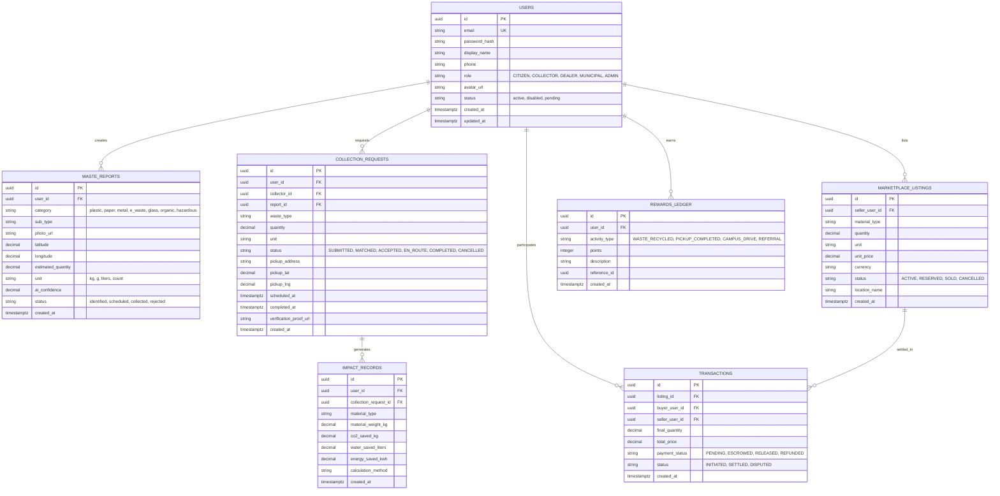
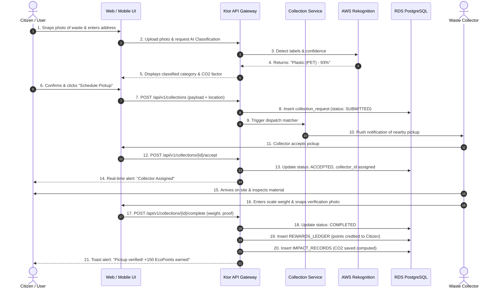

# EcoTrack — System Architecture & Technical Specifications

**Version:** 1.0 (Production Blueprint)  
**Target Cloud:** Amazon Web Services (AWS) — Mumbai Region (`ap-south-1`)  
**Core Framework:** Kotlin / Ktor Modular Monolith  
**Primary Database:** Amazon RDS for PostgreSQL (Multi-AZ)  

---

## 1. High-Level Architecture Diagram

```mermaid
flowchart TB
    %% ==========================================
    %% CLIENT LAYER
    %% ==========================================
    subgraph ClientLayer["📱 Client Presentation Layer (Android Jetpack Compose)"]
        direction TB
        subgraph UI["UI Screens"]
            AuthUI["AuthScreen\n• Citizen & Recycler Personas\n• Instant Zero-Server Demo"]
            DashUI["DashboardScreen\n• Clean Impact Stats\n• Quick Action Pipeline"]
            ScannerUI["ScannerScreen & CameraX\n• ML Visual Detection\n• Auto-Classification"]
            MapUI["NearbyScreen\n• Leaflet 1.9.4 + OSM Tiles\n• Live OSRM Road Polyline\n• Kolhapur Recycling Hubs"]
            CollectorUI["CollectorPortalScreen\n• On-Demand Queue\n• Pickup Lifecycle State"]
            MarketUI["Marketplace & Rewards\n• Recyclables Exchange\n• Eco-Points Ledger"]
            SettingsUI["SettingsScreen\n• AWS Services Spec Sheet\n• Sync & Offline Controls"]
        end

        subgraph ClientCore["Android Core Engine"]
            ApiClient["EcoTrackApiClient\n(Ktor HTTP Client)"]
            LocalCache["Offline Fallback Engine\n(In-Memory Cache & Demo Data)"]
            CamEngine["CameraX Analyzer\n(Edge Pre-Processing)"]
        end

        UI --> ClientCore
    end

    %% ==========================================
    %% GEOSPATIAL & ROUTING LAYER
    %% ==========================================
    subgraph GeoLayer["🗺️ Geospatial & Navigation Engine"]
        OSM["OpenStreetMap (OSM)\nTile Servers\n(tile.openstreetmap.org)"]
        OSRM["OSRM Routing Machine\n(router.project-osrm.org)\n• Driving Waypoints\n• Distance & Duration Matrix"]
    end

    MapUI <-->|"Render Street Tiles"| OSM
    MapUI <-->|"Fetch Live Driving Route & GeoJSON"| OSRM

    %% ==========================================
    %% INGRESS & EDGE LAYER
    %% ==========================================
    subgraph EdgeLayer["🛡️ Edge & Ingress (AWS Cloud)"]
        R53["Amazon Route 53\n(Global DNS)"]
        CF["Amazon CloudFront\n(CDN & Edge Cache)"]
        WAF["AWS WAF\n(DDoS & Bot Mitigation)"]
        ALB["Application Load Balancer (ALB)\n(TLS Termination & Health Checks)"]

        R53 --> CF --> WAF --> ALB
    end

    ApiClient -->|"HTTPS / REST API"| R53
    ApiClient -.->|"Offline Fallback Mode"| LocalCache

    %% ==========================================
    %% BACKEND SERVICES LAYER
    %% ==========================================
    subgraph BackendLayer["⚙️ Backend Micro-Engine (Ktor Modular Monolith)"]
        direction TB
        AuthSvc["AuthService\n(JWT Authentication & RBAC)"]
        WasteSvc["WasteReportService\n(Inspection & Classification)"]
        ColSvc["CollectionService\n(Spatial Haversine Matching & Queue)"]
        MarketSvc["MarketplaceService\n(Listing & Escrow Bidding)"]
        RewardSvc["RewardsService\n(Double-Entry Ledger)"]
        ImpactSvc["ImpactService\n(CO2 / Water / Energy Footprint)"]
        AdminSvc["AdminService\n(Governance & Audit Trail)"]

        ALB -->|"Reverse Proxy / :8080"| BackendLayer
    end

    %% ==========================================
    %% AWS AI & CLOUD SERVICES
    %% ==========================================
    subgraph AwsLayer["☁️ AWS Managed Cloud & AI Services (ap-south-1)"]
        direction TB
        Bedrock["Amazon Bedrock (Claude 3 Haiku)\n• Recycling Advice\n• Contamination Advisory"]
        Rekognition["Amazon Rekognition\n• Computer Vision Labels\n• Waste Material Detection"]
        S3Bucket["Amazon S3\n• Waste Photo Evidence\n• Compliance Certificates"]
        Dynamo["Amazon DynamoDB\n• High-Throughput Telemetry\n• Real-Time Collector GPS Pings"]
        CloudWatch["Amazon CloudWatch\n• Operational Metrics\n• Distributed Logs"]
        Secrets["AWS Secrets Manager\n• Database Credentials\n• API Secrets"]
    end

    WasteSvc -->|"Verify Photo"| Rekognition
    WasteSvc -->|"Material Insights"| Bedrock
    WasteSvc -->|"Store Photos"| S3Bucket
    ColSvc -->|"Collector Pings"| Dynamo
    BackendLayer -->|"Audit & Metrics"| CloudWatch
    BackendLayer -->|"Fetch Config"| Secrets

    %% ==========================================
    %% PERSISTENCE LAYER
    %% ==========================================
    subgraph DataLayer["💾 Data Persistence Layer"]
        Flyway["Flyway Migration Engine\n(V1 to V7 Schema Versioning)"]
        Exposed["Exposed ORM & HikariCP\n(Connection Pooling)"]
        Postgres[("Amazon RDS for PostgreSQL 16\n(Multi-AZ Primary & Standby)\n• Users & Recyclers\n• Waste Reports\n• Collections & Facilities\n• Ledger & ESG Records")]

        BackendLayer --> Exposed
        Flyway --> Postgres
        Exposed --> Postgres
    end

    %% Styling
    classDef client fill:#E8F5E9,stroke:#2E7D32,stroke-width:2px,color:#1B5E20;
    classDef geo fill:#E3F2FD,stroke:#1565C0,stroke-width:2px,color:#0D47A1;
    classDef backend fill:#FFF3E0,stroke:#E65100,stroke-width:2px,color:#BF360C;
    classDef aws fill:#EDE7F6,stroke:#512DA8,stroke-width:2px,color:#311B92;
    classDef db fill:#F3E5F5,stroke:#7B1FA2,stroke-width:2px,color:#4A148C;

    class ClientLayer,UI,ClientCore client;
    class GeoLayer,OSM,OSRM geo;
    class BackendLayer,AuthSvc,WasteSvc,ColSvc,MarketSvc,RewardSvc,ImpactSvc,AdminSvc backend;
    class AwsLayer,Bedrock,Rekognition,S3Bucket,Dynamo,CloudWatch,Secrets,EdgeLayer,R53,CF,WAF,ALB aws;
    class DataLayer,Flyway,Exposed,Postgres db;
```

---

## 2. AWS Cloud Infrastructure Specification

### 2.1 Network Topology (VPC Design)
- **VPC CIDR:** `10.0.0.0/16` deployed across 2 Availability Zones (`ap-south-1a`, `ap-south-1b`).
- **Subnet Segmentation:**
  - `Public Subnet` (`10.0.1.0/24`, `10.0.2.0/24`): Houses internet-facing ALB and NAT Gateways.
  - `Private App Subnet` (`10.0.10.0/24`, `10.0.20.0/24`): Dedicated exclusively to ECS Fargate task instances. Direct inbound traffic from internet is prohibited. Only ingress permitted from ALB security group on TCP `8080`.
  - `Private Data Subnet` (`10.0.50.0/24`, `10.0.60.0/24`): Houses RDS PostgreSQL and ElastiCache. Only ingress permitted from ECS security group on TCP `5432` and `6379`.
- **Egress:** NAT Gateway handles outbound traffic from ECS tasks for external APIs (Google Maps, Twilio, SES).

### 2.2 Compute & Container Orchestration
- **Runtime:** AWS ECS Fargate with containerized Kotlin application on JDK 17 LTS (Alpine / Eclipse Temurin base).
- **Task Scaling Policy:** Target Tracking scaling triggered when average CPU utilization exceeds 70% or active request count per target exceeds 500.
- **Health Checks:**
  - ALB Target Group: HTTP `GET /health/ready` (interval: 15s, timeout: 5s, healthy threshold: 2, unhealthy threshold: 3).
  - ECS Container Healthcheck: `CMD-SHELL curl -f http://localhost:8080/health/live || exit 1`.

### 2.3 Storage & Database Tier
- **Relational DB:** Amazon RDS for PostgreSQL 16 (Multi-AZ enabled for high availability and automatic failover).
- **Object Storage:** Private Amazon S3 bucket (`ecotrack-assets-prod`) encrypted with AWS KMS. Enforces strict presigned URL issuance for both uploads and temporary photo previews.

---

## 3. Database Schema (Key 7 Domain Tables)

The production schema is built around 7 core tables handling the circular economy lifecycle:



---

## 4. End-to-End User Flow & Sequence Diagram

### 4.1 Collection Request & Verification Flow



---

## 5. Technology Stack Summary

| Layer | Selected Technology | Technical Justification |
|---|---|---|
| **Programming Language** | Kotlin 1.9+ / JDK 17 LTS | Type-safety, null-safety, coroutine concurrency, low memory footprint compared to Spring. |
| **Server Framework** | Ktor Server 2.3.12 | Lightweight, non-blocking asynchronous architecture, modular plugin ecosystem. |
| **HTTP Engine** | Netty Engine | Industry-proven high throughput, low latency non-blocking I/O. |
| **Database ORM/Query** | JetBrains Exposed 0.52.0 | Idiomatic Kotlin SQL DSL, type-safe query construction, fine-grained transaction control. |
| **Connection Pooling** | HikariCP 5.1.0 | Fast, lightweight connection pool with proactive connection validation. |
| **Migrations** | Flyway 10.15.0 | Deterministic, version-controlled SQL migrations executed on startup. |
| **Security / Auth** | Auth0 JWT + BCrypt | Stateless, signed claims with HMAC-SHA256, cryptographically salted user credentials. |
| **Cloud Host** | AWS Mumbai (`ap-south-1`) | Minimal latency for target Indian regions, compliant with national data localization norms. |
| **Containerization** | Docker + ECS Fargate | Serverless container execution, zero EC2 OS patching overhead, instant vertical/horizontal scaling. |
| **Client UI (Compose Multiplatform / Android)** | Kotlin + Compose Multiplatform / Jetpack Compose with Material 3 (`androidx.compose.material3`) | 100% unified Kotlin ecosystem sharing DTOs and business logic with Ktor backend; Material 3 dynamic color theming, declarative components, and cross-platform capability across Android, Desktop, and Web. |
