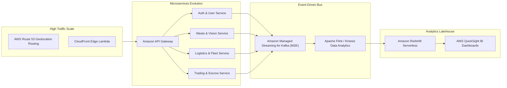

# EcoTrack — Future Roadmap & Long-Term Innovations

**Horizon:** Post-MVP & Production Scale (Months 3–12+)  
**Focus:** Advanced Automation, IoT Sensor Networks, Institutional & Municipal Integrations, Circular Economy Financials

---

## 1. Automated IoT & Smart Hardware Integrations

### 1.1 Smart Dumpster & Bin Fill-Level Telemetry
- **Hardware Architecture:** Ultrasonic distance sensors (ESP32 / LoRaWAN based) attached to community recycling bins and campus trash hubs.
- **Cloud Ingestion:** AWS IoT Core MQTT broker publishing telemetry into EcoTrack EventBridge.
- **Dynamic Routing:** When a bin reaches 80% capacity, an automated collection request is generated and prioritized on the nearest collector's dispatch queue.

### 1.2 Field Logistics & Digital Weight Scale IoT
- **Bluetooth Digital Scales:** Scrap dealers and mobile collection drivers utilize BLE-enabled digital crane/platform scales.
- **Tamper-Proof Weight Verification:** Scale automatically streams weight reading directly to the EcoTrack mobile app, preventing manual entry fraud or human misreporting.
- **NFC / QR Bag Tagging:** Pre-printed reusable QR-coded collection sacks link specific waste loads to user accounts from origin to processing facility.

---

## 2. Advanced AI & Computer Vision Advancements

### 2.1 Edge AI on Mobile Devices (TensorFlow Lite / CoreML)
- Move waste classification inference directly onto user smartphones for zero-latency, offline-capable waste sorting recommendations.
- Instant bounding box detection in live camera view showing material type in real time (e.g. highlight PET bottle green, highlight chip packet yellow).

### 2.2 Contamination & Quality Assessment AI
- For scrap dealers and industrial recyclers, implement secondary vision models that estimate contamination levels (e.g. food residue on cardboard, mixed polymer contamination in shredded plastic bales).

---

## 3. Financial Infrastructure & Circular Marketplace Payments

### 3.1 Digital Escrow & Payment Gateway Integration
- **Partners:** Razorpay Route / Stripe Connect for marketplace transactions.
- **Escrow Workflow:**
  1. Recycler or dealer places offer and deposits funds into escrow.
  2. Seller hands over material to verified collector.
  3. Weight and grade are confirmed via digital signature / OTP.
  4. Escrow funds automatically release into seller's UPI / bank account, deducting platform convenience fee.

### 3.2 Tokenized Green Credits & Carbon Offsets
- Packaging verified carbon diversion certificates into auditable digital green tokens compliant with national voluntary carbon markets (VCM).
- Allows corporate sponsors to purchase certified local recycling credits to satisfy Extended Producer Responsibility (EPR) mandates under national environmental laws.

---

## 4. Municipal Corporation & Smart City Governance (GovTech)

### 4.1 Urban Local Body (ULB) / Smart City Open API Connectors
- Two-way data exchange with city municipal control command centers (ICCC).
- Automated reporting of illegal dumping hot-spots with geocoded photos and timestamps.
- Integration with municipal property tax portals to credit citizen waste segregation discounts directly onto annual property tax assessments.

### 4.2 Fleet Management & Carbon-Optimized Route Dispatch
- Multi-stop Traveling Salesperson Problem (TSP) optimization using AWS Location Service and Google Maps Distance Matrix.
- Minimizes collector vehicle fuel consumption and tailpipe emissions during neighborhood pickup rounds.

---

## 5. Enterprise & Campus ESG Portals

### 5.1 Corporate & University Tenant Dashboards
- Dedicated multi-tenant portals for universities, tech parks, and corporate offices.
- Real-time display of diverted tonnage, Scope 3 greenhouse gas avoidance, and compliance reporting ready for annual sustainability and ESG filings.
- Inter-department and inter-hostel recycling tournaments with live leaderboard displays on campus digital signage.

---

## 6. Scalability & Resilience Evolution (Phase 4+ Infrastructure)

- **Database Scaling:** Introduce Amazon Aurora PostgreSQL with read replicas and automated multi-region replication.
- **Event Streaming:** Introduce Amazon MSK (Managed Kafka) for event-driven telemetry and real-time fleet location streaming.
- **Analytics Lakehouse:** Ingest historical transaction and waste stream records into Amazon Redshift for machine learning models and predictive waste forecasting.
