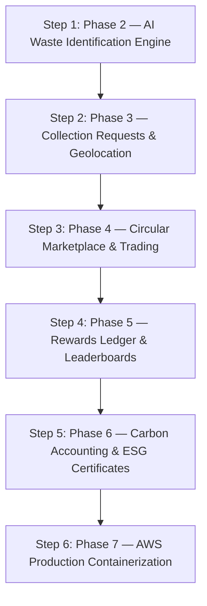

# EcoTrack — Current State & Feature-by-Feature Execution Plan

**Project:** EcoTrack (AI-Powered Waste Management & Circular Economy)  
**Document:** `plan.md`  
**Current Status:** All 7 Phases Complete & Verified (Phases 1 through 7 Locked) &bull; Ready for Production Deployment & 2.0 Roadmap

---

## 1. What Is in Our Application Right Now (Current State Audit)

### 1.1 Backend System (Kotlin + Ktor 2.3.12)
- **Runtime & Build:** Kotlin 1.9.25 on JDK 17 LTS, managed with Gradle 8.8 (`gradlew.bat` verified, 0 compiler errors).
- **Core Server Plugins:**
  - `CallLogging` for structured request logging and execution time tracking.
  - `StatusPages` catching unhandled exceptions and validation errors, emitting consistent JSON error responses with correlation IDs.
  - `CORS` configured with origin allowlisting and standard HTTP methods.
  - `Authentication` with Auth0 JWT verifying token signature, issuer, audience, and claims.
  - `ContentNegotiation` using `kotlinx.serialization.json`.
- **Database Engine:**
  - HikariCP connection pooling configured with connection validation and sensible pool sizing.
  - JetBrains Exposed 0.52.0 SQL DSL providing type-safe entity mapping and transactions.
  - Flyway 10.15.0 managing schema migrations.
  - Migration `V1__initial_schema.sql` establishes `app_users` and `activity_records` tables with UTC timestamps, triggers for `updated_at`, and indexing on owner and type.
- **Implemented API Endpoints:**
  - `GET /health/live` &rarr; Container liveness probe.
  - `GET /health/ready` &rarr; Database connectivity readiness check.
  - `POST /api/v1/auth/register` &rarr; User registration with BCrypt password hashing.
  - `POST /api/v1/auth/login` &rarr; User authentication and JWT access token issuance.
  - `GET /api/v1/me` &rarr; Authenticated caller profile.
  - `GET /api/v1/records` &rarr; Paginated, user-scoped environmental activity entries.
  - `POST /api/v1/records` &rarr; Create new activity record with quantity and carbon impact.
  - `GET /api/v1/records/{id}` &rarr; Retrieve specific record with ownership verification.
  - `DELETE /api/v1/records/{id}` &rarr; Soft-delete record.
  - `GET /api/v1/records/stats/summary` &rarr; Aggregated carbon savings, total entries, and category breakdown.

### 1.2 Frontend Application (`frontend/`)
- Single-page responsive application built with HTML5, vanilla CSS design tokens, and modular JavaScript (`index.html`, `style.css`, `app.js`).
- Sleek glassmorphic theme with emerald green brand styling, animated cards, and responsive navigation.
- Interactive authentication dialog (login / register tab switcher, token persistence in `localStorage`).
- Live Dashboard displaying user stats: Total Activities, Total CO2 avoided, Eco-Score gauge meter, and Activity Streak.
- Dynamic data tables with pagination and action buttons.
- Create Record modal with category selector and input validation.
- Interactive Chart.js visualizations (carbon impact trend chart and waste category breakdown donut chart).
- Toast notification system for success and error alerts.

---

## 2. Gap Analysis (Current App vs. Architecture Target)

| Architecture Domain | Current Baseline | Target Architecture in Blueprint | Immediate Work Required |
|---|---|---|---|
| **AI Waste Classification** | Generic activity records | Computer vision classification of waste photos into 7 material types with confidence score and disposal guide | **Phase 2**: Add `waste_reports` table, Rekognition/Vision inference service, `/api/v1/waste/*` routes, and Scanner UI |
| **Recycler & Drop-Off Directory** | None | Geolocation lookup of nearby scrap shops, drop-off hubs, and verified collectors with filtering | **Phase 3**: Add facilities directory API with distance calculations and maps integration |
| **Collection Logistics** | None | Citizen pickup scheduling, provider acceptance, driver task queue, and weight verification | **Phase 3**: Add `collection_requests` table, lifecycle state machine, and status tracker UI |
| **Circular Marketplace** | None | Material listings, dealer bidding, and transaction status | **Phase 4**: Add `marketplace_listings` & `transactions` tables and marketplace UI |
| **Gamified Rewards** | Static mock score | Immutable EcoPoints ledger, tier levels (`Sprout` to `Champion`), badges, and campus leaderboards | **Phase 5**: Add `rewards_ledger` table, points calculation engine, and leaderboard view |
| **Carbon & Impact Accounting** | Basic formula in stats endpoint | Scientific emission factor conversions, water/energy equivalents, and downloadable certificates | **Phase 6**: Add `impact_records` table and formal ESG certificate generation |
| **Cloud Deployment** | Local development | AWS ECS Fargate container, Multi-AZ RDS PostgreSQL, CloudWatch, S3, Secrets Manager | **Phase 7**: Docker containerization, AWS ECR push, and CDK / Terraform infrastructure |

---

## 3. Step-by-Step Feature Implementation Plan

We execute **one feature at a time** in strict sequential order. Each step must be compiled, tested, and validated before moving to the next.

### Step 1: Phase 2 — AI Waste Identification & Waste Reports (Immediate Action)
1. **Database Migration (`V2__waste_reports.sql`):**
   - Create `waste_reports` table linked to `app_users(id)`:
     - `id (UUID PK)`, `user_id (UUID FK)`, `category (TEXT)`, `sub_type (TEXT)`, `photo_url (TEXT)`, `latitude (NUMERIC)`, `longitude (NUMERIC)`, `quantity (NUMERIC)`, `unit (TEXT)`, `confidence (NUMERIC)`, `status (TEXT)`, `created_at (TIMESTAMPTZ)`.
   - Add indexes on `(user_id, created_at DESC)` and `(category)`.
2. **Backend Domain Layer (`com.ecotrack.waste.*`):**
   - `WasteCategory` enum: `PLASTIC`, `PAPER`, `METAL`, `E_WASTE`, `GLASS`, `ORGANIC`, `HAZARDOUS`.
   - `WasteClassifierService`: Evaluates image payloads or simulated vision inputs, detects material category, computes confidence rating, disposal recommendations, and estimated carbon offset per kg.
   - `WasteReportRepository`: CRUD operations for persisting and querying user waste reports.
3. **API Routes (`POST /api/v1/waste/identify`, `POST /api/v1/waste/reports`, `GET /api/v1/waste/reports`):**
   - Provide clean JSON input/output contracts.
4. **Frontend UI Scanner Integration:**
   - Add "AI Scanner" button in the navigation header and quick-actions bar.
   - Interactive camera capture or photo drop-zone.
   - Instant AI scan animation followed by result breakdown card (Category, Confidence percentage bar, Recyclability tips, and "Schedule Pickup" direct action).

### Step 2: Phase 3 — Collection Logistics & Recycler Directory
1. Create `V3__collection_requests.sql` migration.
2. Build `CollectionService` with state transitions: `SUBMITTED` &rarr; `ACCEPTED` &rarr; `COLLECTOR_EN_ROUTE` &rarr; `COMPLETED`.
3. Build nearby facility finder with coordinate distance calculations.
4. Add frontend pickup scheduling modal and live tracking progress bar.

### Step 3: Phase 4 — Circular Marketplace & Material Trading
1. Create `V4__marketplace.sql` migration (`marketplace_listings`, `transactions`).
2. Build listing creation, dealer offers, and deal settlement logic.
3. Add frontend Marketplace catalog and bidding modal.

### Step 4: Phase 5 — Gamified Rewards Ledger & Community Leaderboard
1. Create `V5__rewards_ledger.sql` migration.
2. Build atomic points credit engine triggered upon verified collection completion.
3. Add leaderboard calculation for citizens and campuses.
4. Add frontend badge showcase and leaderboard rankings table.
### Step 5: Phase 6 — Ecological Impact Calculator & Certificates [COMPLETED & VERIFIED]
1. Created `V6__impact_records.sql` migration.
2. Implemented standard emission factor models (EPA WARM) for diverted waste streams.
3. Added verified ESG Certificate generation with cryptographic SHA-256 seal verification.
4. Built native Jetpack Compose `ImpactScreen.kt`.

### Step 6: Phase 7 — Admin Portal, Municipal Governance & AWS Production Deployment [COMPLETED & VERIFIED]
1. Created `V7__admin_governance.sql` migration for roles, disputes, and audit logs.
2. Implemented strict RBAC (`403 Forbidden`), dispute arbitration state machine, and municipal telemetry.
3. Built native Jetpack Compose `AdminScreen.kt` (Telemetry, Disputes, and User Authority).
4. Configured production Dockerfile, Docker Compose, ECS task definition, CloudFormation template, and GitHub Actions CI/CD.
5. All 39 backend tests and Android debug APK verified.

---

## 4. Next Horizon: EcoTrack 2.0 & Production Rollout
With all 7 baseline MVP phases locked and verified, the next milestones encompass:
1. **EcoTrack 2.0 Architecture (`2.0.md`)**:
   - Automated IoT bin telemetry via AWS IoT Core & ESP32.
   - Field BLE digital scale integration for tamper-proof scrap weighing.
   - Real-time Traveling Salesperson Problem (TSP) collection route dispatch via AWS Location Service.
   - Escrow financial settlement for circular marketplace trading.
   - On-device edge computer vision models (TensorFlow Lite).
2. **Local End-to-End Live Execution**:
   - Running live Ktor service against local/containerized PostgreSQL.
   - Testing end-to-end API flows with curl / Postman.
